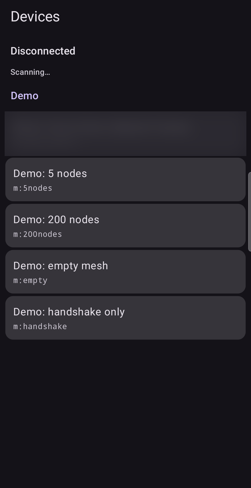

# Connecting

The app talks to your Meshtastic node over **Bluetooth Low Energy**. It reads the node's
database, then listens to every packet the node receives. It only asks the node for its
configuration and database and sends keep-alive signals. It does not change any setting on your
node and does not send messages to the mesh.

## The Devices screen

When the app opens you see the **Devices** screen:

- **Disconnected / Connecting / Connected** shows the state of the connection. While connected, a
  **Disconnect** button appears.
- **Scanning…** means the app is looking for nodes nearby.
- **Available devices** lists nodes found by the scan. **Paired devices** lists nodes your phone
  already knows.
- **Demo** lists built-in demo devices (see below).

Tap a node to connect.

## Before the first connection

| Message on screen | What to do |
| :--- | :--- |
| **Permissions needed** | Tap **Grant permissions**. The app needs Bluetooth permission to find and connect to your node. |
| **Bluetooth is off** | Turn Bluetooth on. The app continues by itself when it comes back. |
| **Bluetooth not supported** | This phone lacks Bluetooth Low Energy, which the app requires. |
| **No devices found** | Check that the node is powered on and Bluetooth is enabled, then scan again. |

## Pairing

The first time you connect to a node, Android asks for a pairing code. The code appears on the
node's own screen. Read it there and type it on the phone. You have about **two minutes**.
If pairing does not complete, the app tells you whether the node did not answer or the code was
not accepted, and you can try again.

After a successful handshake, the app shows the **Relays** screen. The header line shows the
number of nodes in the node database (`DB`).

## If the connection drops

The app shows a clear message (for example "The connection was lost" or "The node is out of
range"). Return to range, then connect again from the Devices screen.

## The demo device

**Debug builds** also include demo devices, shown in the **Demo** section. They replay made-up
traffic so you can try every screen without a node. Release builds do not have them. In the demo
list, only the scenario that models a small regional mesh produces a continuing stream of
packets; the others stop after the handshake.

**In practice.** You have just bought a node and the antenna is not fitted yet. Open a demo
device and tap through the screens with this guide beside you. Connect your real node only when
you are ready to measure.

Next: [Relays](02-relays.md).
