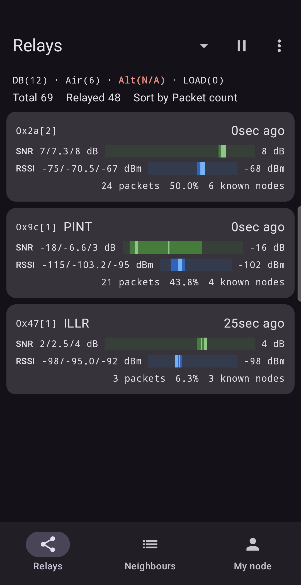
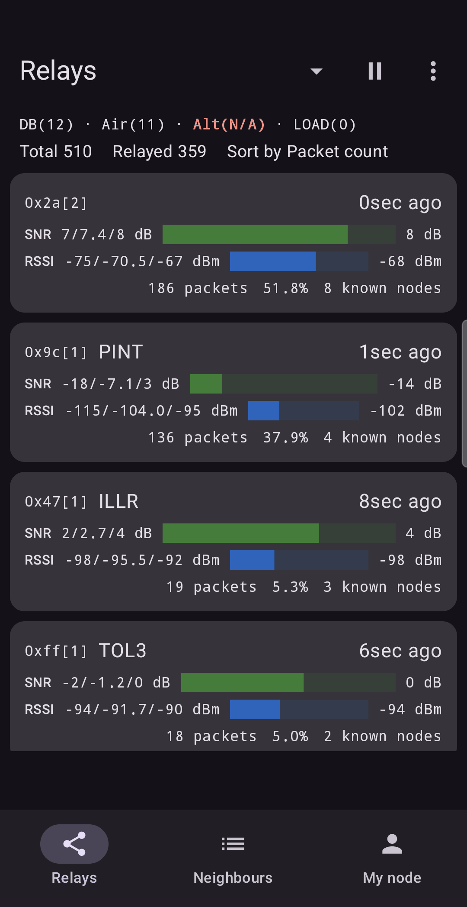
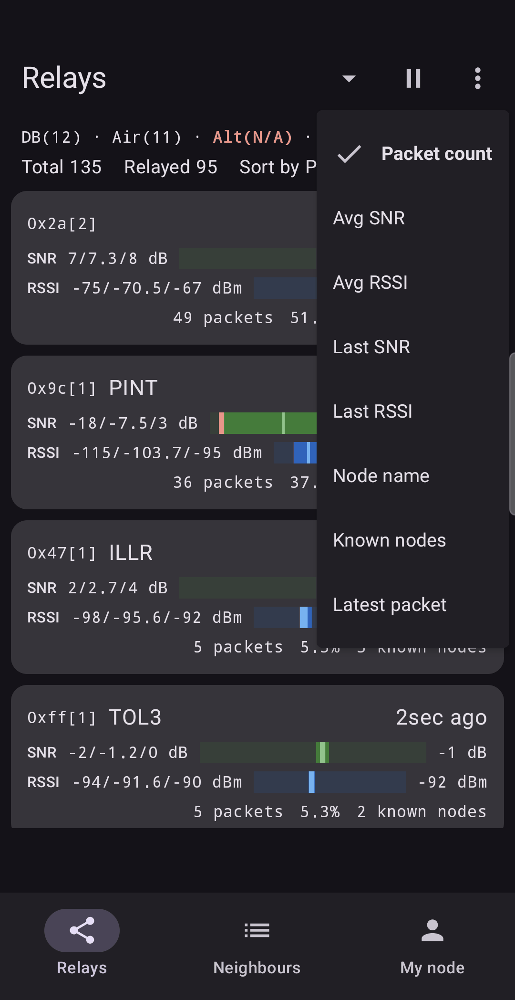
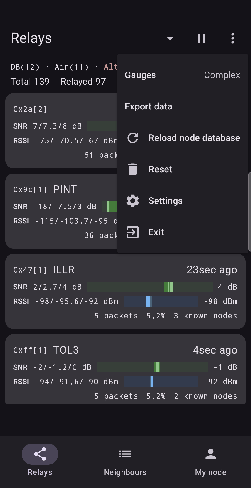
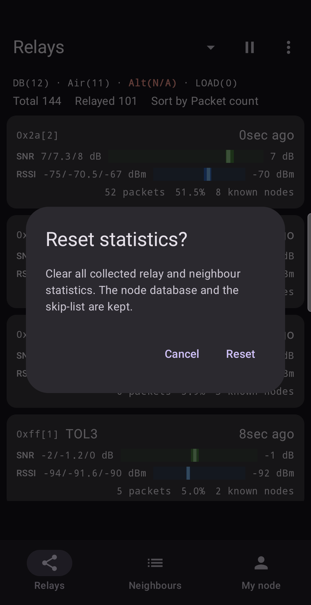
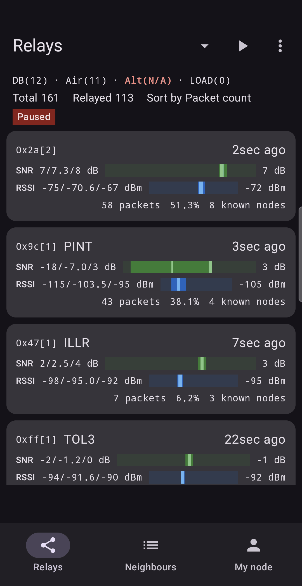

# Relays

The **Relays** tab is the main screen. It lists every relay your node has heard forwarding
packets to it, one card per relay byte.

## Reading the header

Two lines sit above the cards.

- **`DB(12) · Air(6) · Alt(N/A) · LOAD(0)`**
  - `DB`: nodes read from your node's own database.
  - `Air`: nodes the app learned about from packets it heard.
  - `Alt`: your altitude, when known (`N/A` if not).
  - `LOAD`: nodes loaded from a saved file ([Saving data](07-data.md)).
- **`Total 69   Relayed 48   Sort by Packet count`**
  - `Total`: all packets received since the start or the last Reset.
  - `Relayed`: those that arrived through a relay. Only these appear as cards.
  - Packets that arrive directly are on the [Neighbours](04-neighbours.md) tab.

## Reading a relay card

Each card is one relay byte.

| Part | Meaning |
| :--- | :--- |
| **`0x2a[2]`** | The relay byte in hex. The number in brackets says how many nodes in your database could be this relay. |
| **A name** (`PINT`) | Shown only when exactly one node matches. With `[2]` or more, no name is shown, because the app would be guessing. |
| **`0sec ago`** | How long ago the latest packet via this relay arrived. |
| **SNR `7/7.3/8 dB`** | Lowest, average and highest SNR of its packets. The bar and the number on the right show the latest value. |
| **RSSI `-75/-70.5/-67 dBm`** | The same for signal strength. |
| **`24 packets  50.0%`** | How many packets it carried, and its share of all relayed packets. |
| **`6 known nodes`** | How many different remote nodes sent packets through this relay. |

Tap a card to open its [details](03-relay-details.md).

### Gauges: Simple and Complex

You can choose how the bars are drawn (menu ⋮ → **Gauges**, or [Settings](08-settings.md)).

- **Simple** shows only the latest level as a filled bar.
- **Complex** (first screenshot above) shows a band from the lowest to the highest value seen,
  with thin marks for the average and for the latest packet. The latest mark flashes briefly
  when a new packet arrives.

A narrow band means a steady signal. A wide band means it varies, which is typical of a weak or
obstructed link.

## Sorting

The arrow next to the title opens the sort list.

You can sort by **Packet count**, **Avg SNR**, **Avg RSSI**, **Last SNR**, **Last RSSI**,
**Node name**, **Known nodes** or **Latest packet**. The default sort is set in
[Settings](08-settings.md).

## Pause, Resume and Reset

- **Pause** (the ⏸ button) freezes the statistics, and the status line shows **Paused**. Packets
  that arrive meanwhile are not counted (the node database keeps learning). The button turns into **Resume**.
- **Reset** (⋮ → **Reset**) clears all relay and neighbour statistics so you can start a fresh
  measurement. It also **clears the Graph history**, so anything you have not exported is gone. It keeps
  the node database, your skip list and your bookmarks. A confirmation window appears first.

- **Reload node database** asks your node for its database again, for example after it has
  learned new nodes.
- **Exit** disconnects, stops collecting and closes the app. Statistics from the session are not saved.

## When the screen is empty

If you see **No relays yet**, no forwarded packets have arrived. Wait. A quiet mesh
can take a while, and a node with no neighbours will never show relays.

## In practice

**Which of my forwarders is the best?** Once the relays on a windowsill have carried a few dozen packets, three cards are on the
screen. The top one carried half of all packets with an average SNR near +7 dB. The bottom one
carried only a few, at +2 dB. Sorting by **Avg SNR** puts the clean relays first. You now know
which forwarder you depend on, and which is marginal.

**Aim a separate antenna.** The cards make it easy to pick the relay with the best reception.
Take a separate directional antenna, aim it at that relay, and use the same cards to check whether the
relay's average SNR improves. That relay becomes your reference for the antenna you tune.

**Did my change help?** Move the node to a new spot. Tap **Reset**. Wait until the same relay has carried a similar number of packets (at least 10–15).
Compare the top card's average SNR with the one you wrote down before. If it went up by several
dB, the new spot is better for that relay.

Next: [Relay details](03-relay-details.md).
