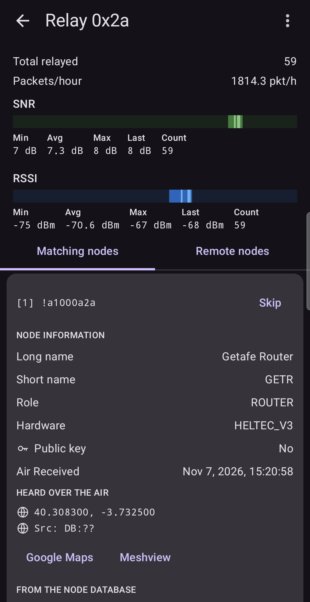
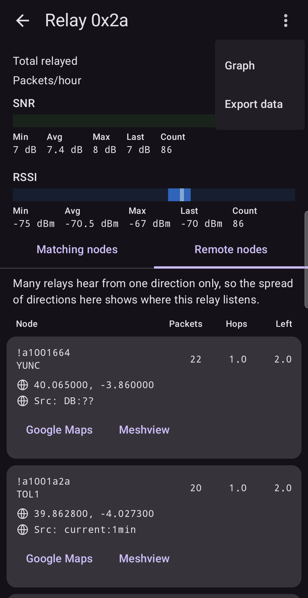
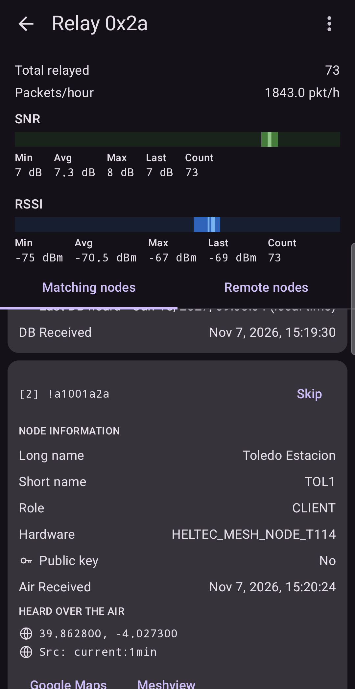
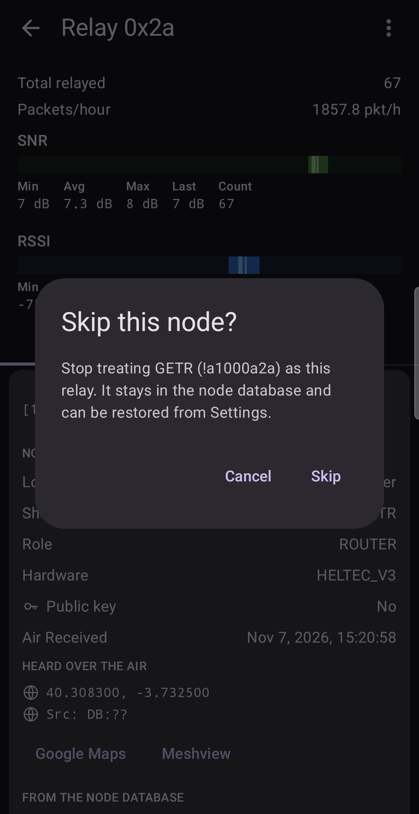
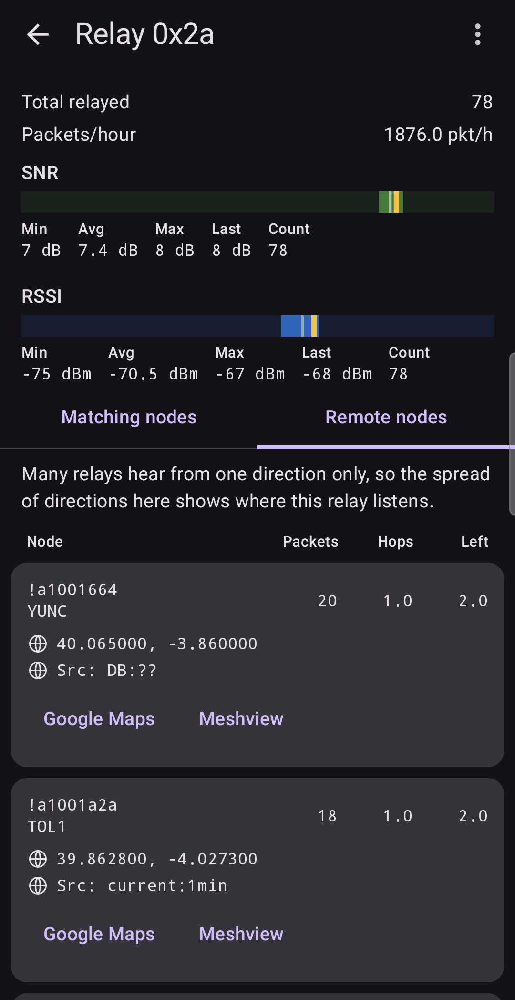
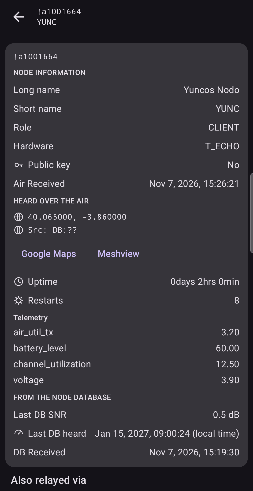

# Relay details

Tap a relay card to open its detail screen. It answers three questions:

1. How good is this relay's signal here? (the numbers and indicators at the top)
2. Which node is it? (the **Matching nodes** tab)
3. Whose traffic does it carry? (the **Remote nodes** tab)

## The numbers and indicators

Everything here is counted **since the last Reset** (or since you connected, if you never reset).

- **Total relayed**: packets carried by this relay, since the last Reset.
- **Packets/hour**: the rate at which they arrive, measured from the first packet after the last Reset to the latest one. In a short session this is an estimate, not a promise.
- **SNR** and **RSSI** gauges, each with **Min**, **Avg**, **Max**, **Last** and **Count**, since the last Reset.

The ⋮ menu offers the [Graph](06-graph.md) and **Export data** ([Saving data](07-data.md)).

## Matching nodes

This tab lists the nodes in your database whose number ends in this relay byte. The relay is
probably one of them, though it may also be a node your node has not heard of yet.

Each candidate is numbered `[1]`, `[2]`, … and shows its node card: names, **role**, **hardware**,
coordinates and a few more facts. The card has two parts:

- **HEARD OVER THE AIR**: what the app learned from packets during this session.
- **FROM THE NODE DATABASE**: what your node already knew.

Useful fields on a card:

| Field | Why it matters |
| :--- | :--- |
| **Role** | A `CLIENT_MUTE` node never forwards packets, so it cannot be your relay. Every other role can (a `ROUTER` does it by design). A node can also be set up not to forward without showing it. |
| **Coordinates**, distance and direction | Where the candidate is relative to you. Open it on a map with **Google Maps** or another map app. |
| **Uptime** and **Restarts** | A long uptime with few restarts suggests a stable relay. Many restarts may mean power trouble, for example a solar node running flat at night. |
| **Telemetry** (battery, voltage) | Tells you whether a relay may go offline when its battery runs low. |
| **Last DB SNR** | The signal your node measured when it last heard this candidate directly. |
| **Meshview** | A link to the node's page on your Meshview site, if you set one ([Settings](08-settings.md)). |

If you see **No matching nodes**, no node in your database ends in this byte. The relay may not
have announced itself yet. Wait, or reload the node database.

### Skipping a candidate

Suppose a relay shows `[2]` but you know one of the two is far away or switched off. Tap
**Skip** next to it, and confirm.

The app stops treating that node as this relay. If one candidate remains, its name appears on the
relay card, and a **Skipped nodes** line appears among the numbers at the top. The node stays in
your database. To undo, use **Clear skipped nodes** on the Matching nodes tab (it asks you to
confirm, and affects only this relay), or open [Settings](08-settings.md) and remove the node
from the skipped list, or clear the whole list.

## Remote nodes

This tab lists the nodes whose packets this relay forwarded to you.

| Column | Meaning |
| :--- | :--- |
| **Node** | The sender, with its position when known. |
| **Packets** | How many of its packets came through this relay. |
| **Hops** | On average, how many times those packets had been forwarded when they reached you. This includes the relay you heard. |
| **Left** | On average, how many more forwards the packets still allowed. |

**Hops + Left** is the forwarding limit the sender set. For example, `Hops 1` and `Left 2` means the
sender allowed 3 forwards and one had happened: sender, relay, you. A larger Hops number means a
more distant sender.

If the same node also reached you through another relay, a line says **Also relayed via** with
that relay. A node that appears under two relays gives you **two paths**, which matters for
reliability.

Many relays hear from one direction only. When all the remote nodes lie to the north-east, for
example, you have learned where that relay listens.

Tap a node to open its own page.

## In practice

**Choosing a spot for a new node.** You are deciding between two places on a roof. At the first,
the relay screen shows one strong relay and nothing else. At the second, three relays each
carry traffic, with slightly lower SNR. Redundancy is worth more than the single best number:
if the strong relay restarts, the second place keeps you connected.

**Spotting a fragile relay.** A relay that carries half your traffic has a `Restarts` count of
eight and falls silent at night. It is a single point of failure. Plan another route.

**Does a far-away node reach me through one path or two?** Open its page under two relays. Two
paths: you are safe if one fails.

**I need a link to one particular node.** The packets of the node you care about reach your spot only
through relays. Open that node's page under each relay that carries it (the **Remote nodes** tab shows
**Packets** per relay, and **Also relayed via** lists the others). Now you know through which relays its
traffic arrives, and which of them carry most. Treat those relays as your priority: aim an antenna at
them, protect their power, and judge any change of position by how their SNR changes.

Next: [Neighbours](04-neighbours.md).
