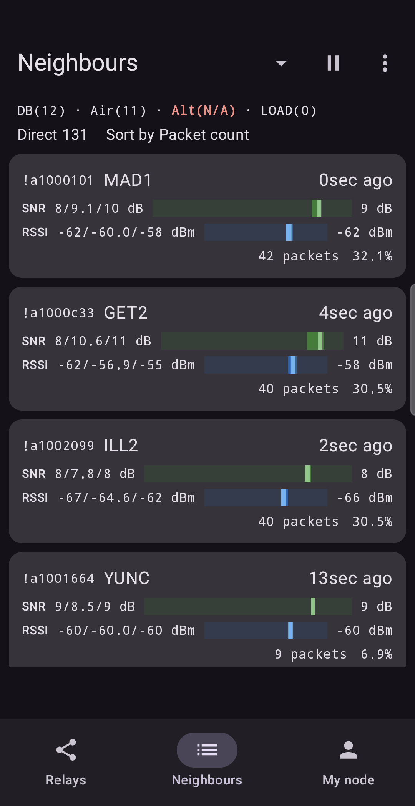
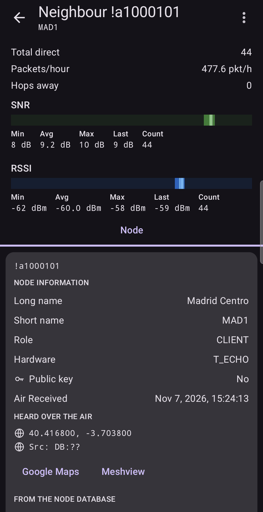

# Neighbours

The **Neighbours** tab lists nodes whose packets reach you **directly**, without any relay in
between. Where the Relays tab answers "who forwards to me?", this tab answers "who can I hear
myself?".

## How the app decides that a packet is direct

Every packet records how many forwards it is allowed (the hop limit set by the sender) and how many
are left. A packet counts as **direct** when:

- it has not been forwarded yet (the two numbers are equal), and its relay byte is the sender's own
  byte, as every node announces itself on a packet it sends, or
- it has no relay byte at all (see [Limits](10-limits.md)).

Everything else counts as **relayed** and goes to the [Relays](02-relays.md) tab.

## Reading the screen

The header is the same as on Relays, except the status line reads **Direct** (the number of
packets received directly) in place of Total and Relayed.

Each card is one node:

- its **node ID** and **short name**,
- how long ago it was last heard,
- **SNR** and **RSSI**: lowest, average and highest, with a gauge and the latest value,
- how many **packets** it sent directly, and its share of all direct packets.

The same sorting, **Pause**, **Reset** and **Gauges** controls work here as on Relays
([Relays](02-relays.md)).

If the list is empty, you see **No neighbours yet**. That means no packet has arrived directly.
Nodes whose traffic reaches you through a relay are on the Relays tab.

## Neighbour details

Tap a card to open the node's page.

It shows **Total direct** packets and **Packets/hour**, the same **SNR** and **RSSI** blocks as on
a relay, and the node's own card (identity, role, hardware, position, telemetry). The ⋮ menu
leads to the [Graph](06-graph.md) of that neighbour and to **Export data**.

## Why a neighbour can also be a relay

A node close to you may appear both here and on Relays. Direct packets from it are neighbour
traffic. If it also repeats packets from others, those arrive as relayed traffic, and it
appears as a relay too. The two tabs count different packets, so the numbers differ.

## In practice

**Is my antenna hearing my own street?** Neighbours with a strong signal (for example +9 dB)
confirm that the antenna works well at short range. Neighbours that fade or never appear while
you know they are nearby suggest a poorly placed or mismatched antenna.

**Who is my backbone?** Compare the neighbours with the relays. Nodes in both lists are your most
useful connections: you hear them directly, and they also carry others to you.

Next: [My node](05-my-node.md).
