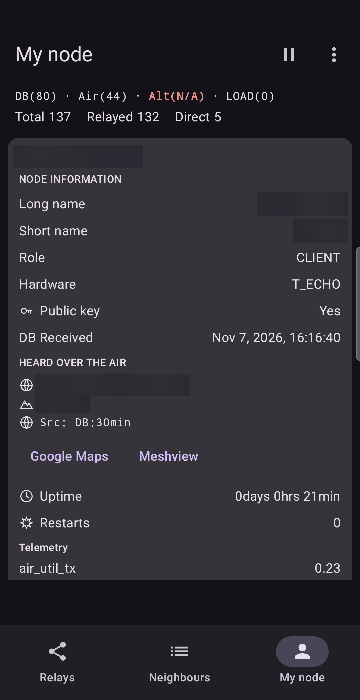
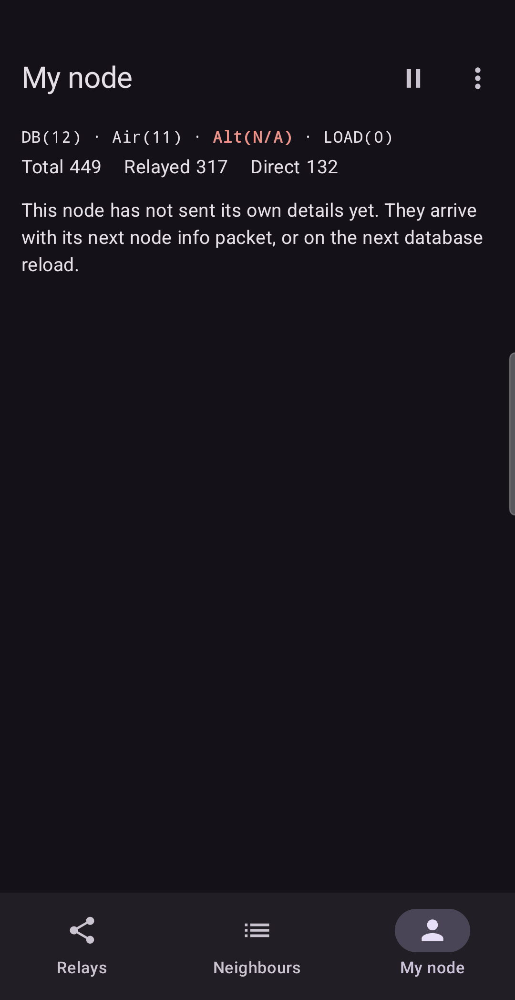
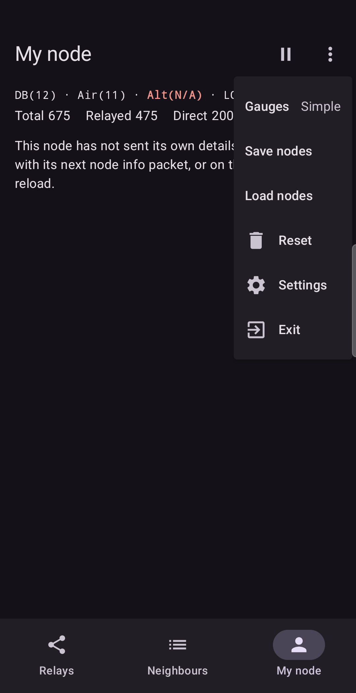

# My node

The **My node** tab shows the node you are connected to: who it is, what it is, where it is and
how it is doing.

The status line at the top shows the **Total**, **Relayed** and **Direct** packet counts. The card
below is your node's own card, like the cards in [Relay details](03-relay-details.md). (In the
screenshot the node's names, coordinates and altitude are hidden.)

## What the card shows

| Field | Meaning |
| :--- | :--- |
| **Long name**, **Short name** | The names set on your node. |
| **Role** | The device role, for example `CLIENT` or `ROUTER`. |
| **Hardware** | The device model. |
| **Public key** | Whether the node has announced a public key. |
| **DB Received** / **Air Received** | When the information arrived: from the node's database, or from a packet the node sent over the air. |
| **Coordinates**, **Altitude**, **Position source** | Where the node says it is. The source reads, for example, `Src: DB:30min`: from the node database, 30 minutes old. See below. |
| **Google Maps**, **Meshview** | Links to the node on a map, or on your Meshview site. |
| **Uptime**, **Restarts** | How long the node has been running and how many times it restarted. |
| **Telemetry** | Values the node reports about itself, for example how busy its transmitter has been. |

The card has two parts, **HEARD OVER THE AIR** and **FROM THE NODE DATABASE**, as on any node card.

## Your node as a source of coordinates

The app stamps each measurement with where *you* were. It takes that position from one of two places,
chosen with **Use phone location** in [Settings](08-settings.md):

- **On:** the phone's own position. Good when you walk around with the phone.
- **Off:** the position of your node, the one shown on this card. The phone's GPS is not switched on.
  Good when the node sits in a fixed place with a good position.

So the **Coordinates** and **Altitude** on this card can become the coordinates and altitude of every
measurement, bookmark and exported row. If the card shows no position, or an old one, measurements taken
with the node as the source carry nothing, or carry an outdated place.

## Getting fresh information about your node

Your node announces itself from time to time. If the card is old or empty you can:

- **Wait.** The next node-info packet, or the next position packet, updates the card by itself.
- **Reload the database.** On the Relays tab, open ⋮ → **Reload node database**. The app asks the node
  to send its configuration and its database again, including its own details. Statistics and your skip
  list are kept.

## When the tab is almost empty

Right after connecting you may see: *This node has not sent its own details yet. They arrive with its
next node info packet, or on the next database reload.* This is normal. Wait a few minutes, or reload the
node database as above.

## The menu

Besides **Gauges**, **Reset**, **Settings** and **Exit**, this menu holds **Save nodes** and
**Load nodes**. They keep the nodes you have learned, your notes, bookmarks and skip list in a file. See
[Saving data](07-data.md).

## Your own node is not counted

The app leaves your own node out of the statistics, so a relay card never shows your node as
forwarding to itself.

## In practice

**Which position do my measurements carry?** You test an antenna on a rooftop. Your node is fixed there
and has a good position, so you leave **Use phone location** off. Every measurement and bookmark then
carries the node's coordinates and altitude, and the phone's GPS stays off, which saves battery. Later you
walk around the roof with the phone: now you turn **Use phone location** on, so each bookmark remembers
where *you* stood.

**Is the position I rely on fresh?** On the card you read `Src: DB:??` or an age of many hours. The node
has had no recent position, so the map links point at an old place. Wait for a new position packet,
reload the node database, or switch to the phone's position.

Next: [Graph](06-graph.md).
