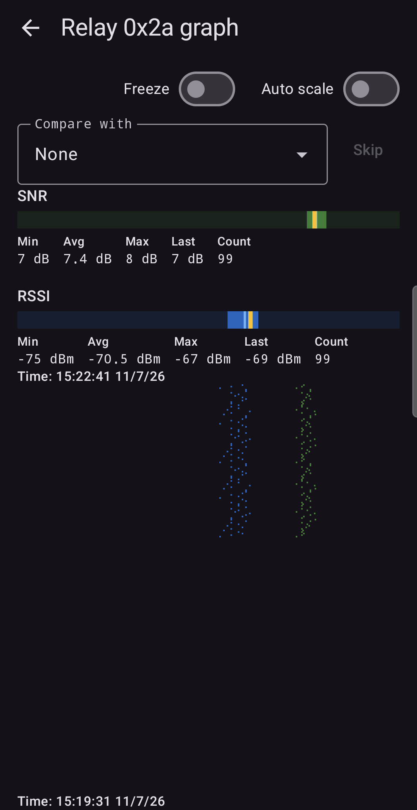
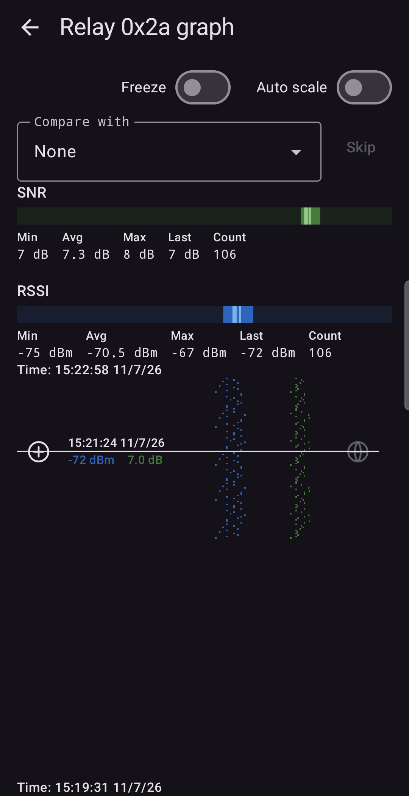
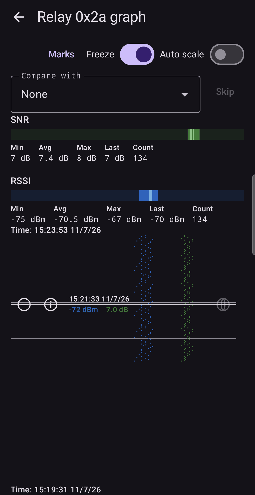
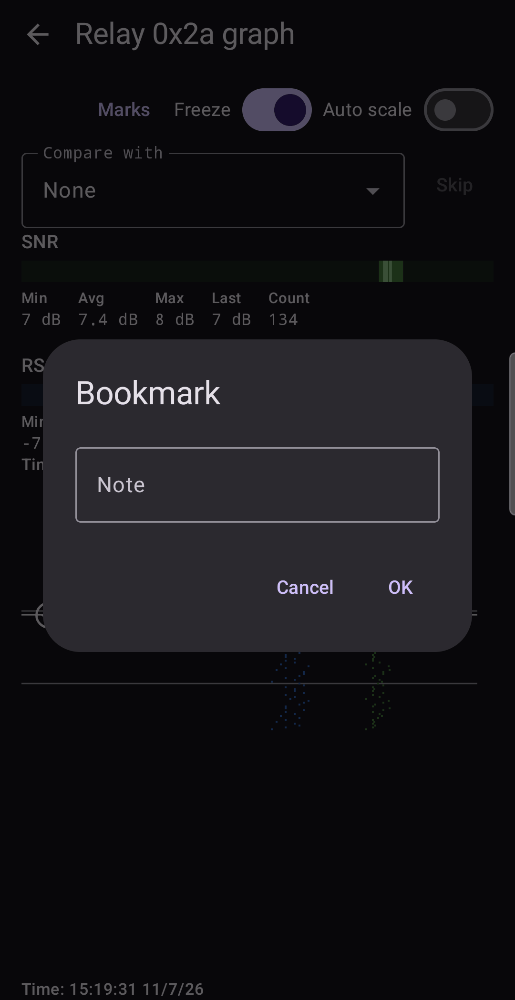
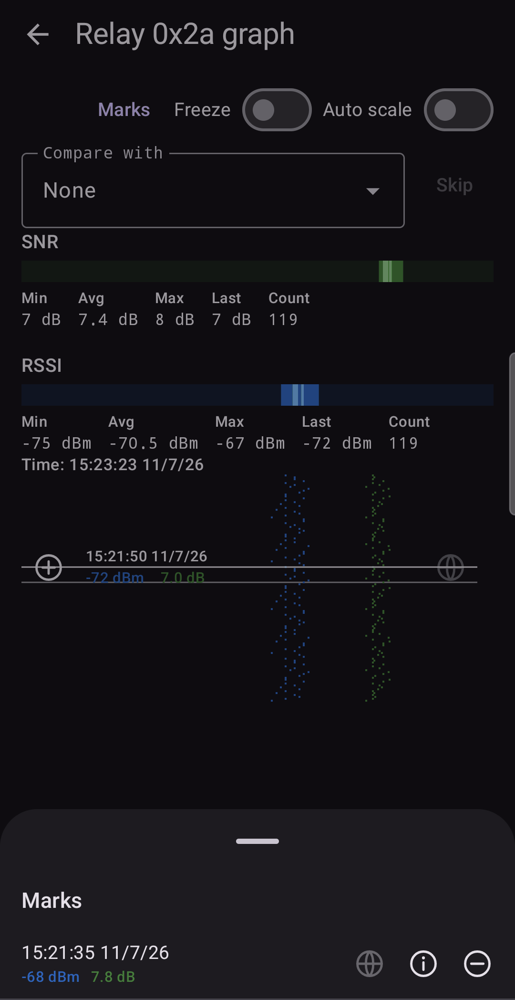
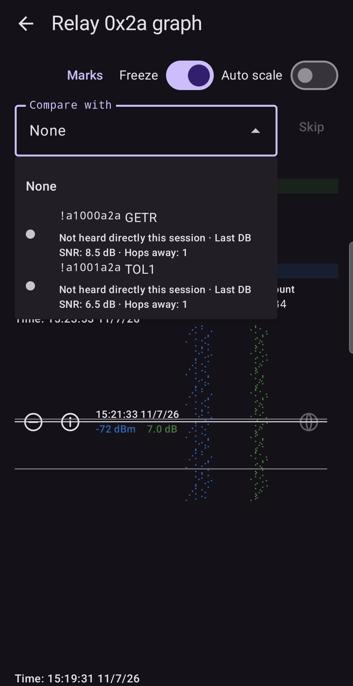
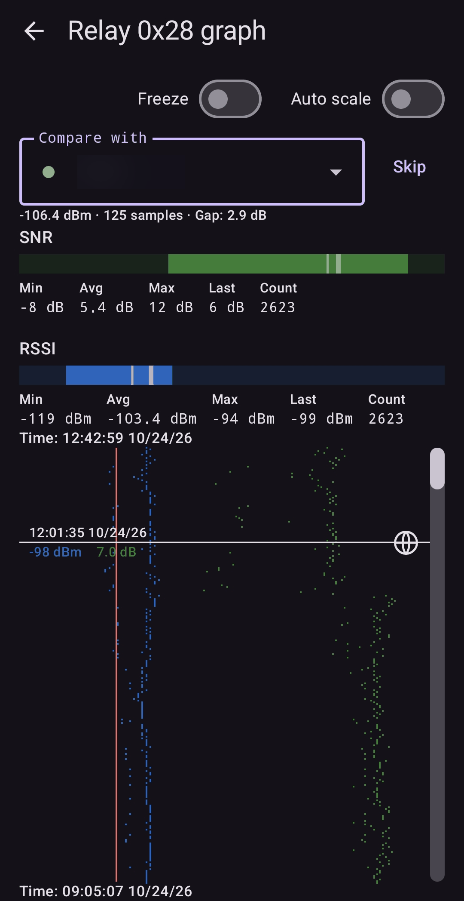

# Graph

The Graph shows how the signal of one relay (or one neighbour) changed over time. Where the cards
give you averages, the Graph lets you see *when* the signal was good or bad.

Open it from a detail screen: ⋮ → **Graph**.

## Reading the Graph

- The title says what you are looking at, for example **Relay 0x2a graph**.
- Below the controls, two **gauges** (SNR and RSSI), each with its numbers for the whole series
  (Min, Avg, Max, Last, Count). The gauge is also the **scale** of the plot below it.
- The big area shows one **row per received packet**. **Green dots** are SNR and **blue dots**
  are RSSI. A dot's horizontal position is its value on the matching gauge: the green dots line up
  with the SNR gauge above, the blue dots with the RSSI gauge. A dot to the right is a stronger
  value. For an exact number, use the crosshair (below).
- The **newest packets are at the top**. As more arrive, the picture grows downward. The time
  of the newest row is shown above the plot and the time of the oldest row below it.
- You can scroll back through the history. The app keeps the most recent 5000 packets per subject.

A tight column of dots means a steady signal. A scattered column means a changeable one.

## Controls

- **Freeze** holds the drawing still so you can examine it. Collection continues in the
  background.
- **Auto scale** stretches the scales to fit the values, which helps when the signal varies
  within a narrow range.

## The crosshair

Tap or drag on the plot to place a crosshair on one packet.

The crosshair shows that packet's **time**, **RSSI** and **SNR**, and the observer's **altitude** if it was
known at that moment. At its ends are two buttons:

- **⊕ Add bookmark**: remembers this measurement (see below).
- **🌐 Open this measurement on a map**: opens the place where *you* were when the packet
  arrived. It is greyed out when no position is available. See [Settings](08-settings.md) for
  where positions come from.

## Bookmarks and Marks

A **bookmark** records one measurement, with its time, signal, your position and a note. Use it to
mark "here, the signal was good".

On a bookmarked row the buttons change:

- **⊖ Remove bookmark** (after you confirm),
- **ⓘ Bookmark info**: edit the **Note**.

Once a bookmark exists, a **Marks** button appears at the top. It opens the list of all
bookmarks, with the same three buttons on each.

A **long press** on the plot moves the crosshair to the next bookmarked row, newest first.
Bookmarks belong to the **relay byte**, not to one candidate, so they stay put while you decide
which node is behind it. A reset of the statistics does not delete them. They are saved
with **Save nodes** ([Saving data](07-data.md)).

## Comparing candidates

On a relay graph, the **Compare with** list lets you pick one of the relay's candidate nodes.

Each entry shows what the app knows about the candidate: whether it was **heard directly this
session**, its **last database SNR** and its **hops away**.

**The idea.** A relayed packet reaches you from the relay itself, so the relay's signal is the
same link you would measure if you heard that node's own packets directly. If a candidate really
is the relay, its direct signal and the relay's signal should agree.

When your node has heard the chosen candidate directly (or the node file you loaded holds its
averages), two vertical lines appear on the plot: a **red line at the candidate's average RSSI**
and a **yellow line at its average SNR**. The closer the relay's dots sit to the lines, the more
likely that candidate is the relay.

Next to each candidate in the list, a **coloured dot** shows the verdict. The **Gap** is the difference
in dB between the candidate's average direct RSSI and the relay's average RSSI.

| Dot | Verdict | When | Meaning |
| :--- | :--- | :--- | :--- |
| Green | **Consistent** | Gap up to 6 dB | Within the normal variation of one link. |
| Amber | **Uncertain** | Gap above 6 and up to 15 dB | More than normal variation, less than a different node would give. |
| Red | **Inconsistent** | Gap above 15 dB | Very unlikely to be the same transmitter. |
| Grey | **Not yet compared** | The candidate has not been heard directly | No evidence either way. It is not a rejection: a quiet router may simply not have spoken during a short session. |

Candidates are listed from most to least consistent. A candidate that cannot forward packets at all
(role `CLIENT_MUTE`) is marked **Cannot forward**. The app ranks and colours; it never decides for
you. **Skip** next to the list removes the chosen candidate from consideration.

### Using it: choose a candidate to draw the lines

1. Open the Graph of a relay that shows `[2]` or more candidates.
2. Open **Compare with** and choose a candidate, for example the one with a green or amber dot.
3. Two vertical lines appear: red at that node's average RSSI, yellow at its average SNR. Look at
   where the relay's dots sit relative to them.
4. Choose the next candidate and compare again. The candidate whose lines pass through the relay's
   dots is the likeliest relay.

## Two clusters of dots

Sometimes the dots of a relay form **two separate groups**: one with low RSSI and one with high RSSI. For
a relay this usually means you are really receiving **two different nodes whose numbers end in the same
byte**, so the app has merged two relays into one card. Turn on **Auto scale**: it stretches the plot to the
values present and makes the two clusters much easier to see. Choose a candidate in **Compare with** and
see which cluster its lines match.

*A real example, taken with an earlier version of the app: it draws only the red line, and shows the
candidate's figures as a text line under the list instead of the yellow SNR line. The candidate's name is
hidden.*

How to read it:

- The title says **Relay 0x28**: one card, one byte. But the blue dots (RSSI) form **two groups**: a
  sparse, weaker one on the left and a denser, stronger one to its right. The green dots (SNR) form two
  groups as well.
- **Compare with** has a candidate chosen, with a green dot (a consistent match). The **red vertical
  line** is that candidate's average RSSI when heard directly (here −106.4 dBm, from 125 samples). It
  runs along the **left** group.
- So the candidate explains the weak group. The strong group on the right cannot be that node: it is
  another node whose number ends in the same byte, and the card was merging both.
- The **Gap** of 2.9 dB is measured against the relay's *overall* average (−103.4 dBm), which sits
  between the two groups. When a card has two groups, trust the line against the dots more than the
  gap.

**Matching a node you know to a relay's traffic.** Choose the node in **Compare with** and see which
group the red (and, in the current version, yellow) line passes through. That group is the traffic of
that node. Choose another candidate for the other group. Then **Skip** the nodes that are not the relay
you follow, so that the card shows the node you care about.

## In practice

**A walk test.** Open the Graph of your best relay and take a slow walk around the house with the
phone and node in hand. Back at the screen, scroll through the history: the rows where the dots
move to the right are the places where the signal was best. Add a bookmark at each, with a note
such as "kitchen window".

**Aiming a directional antenna.** Turn the antenna a few degrees at a time, pausing at each heading
until at least 10–15 new rows have appeared. The Graph shows each step as a block of rows. Bookmark the heading where the
SNR dots sit furthest to the right.

**Two relays behind one card.** The relay `0x2a[2]` shows a loose cloud of dots. With **Auto scale** on, it
splits into a strong group and a weak group. You pick each candidate in **Compare with**: one candidate's
lines match the strong group, the other's match the weak group. The card was merging two nodes that
share a byte. Skip the one you do not want to follow ([Relay details](03-relay-details.md)).

**Is that interference?** If RSSI sits high but SNR is poor and scattered on every relay, the
noise floor is raised by something nearby, not by distance. Move the node away from chargers,
screens and routers and watch whether the SNR dots shift right.

Next: [Saving data](07-data.md).
