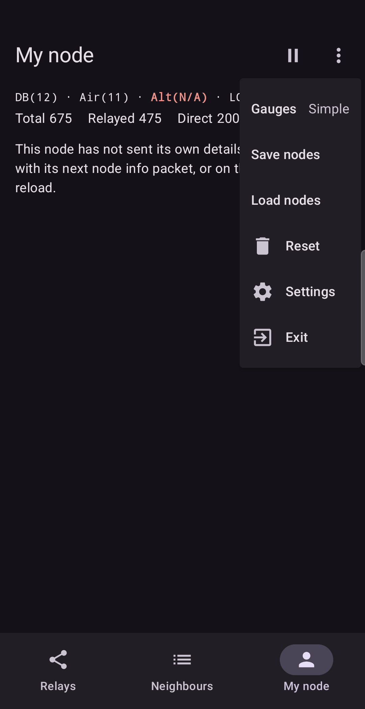

# Saving data

The app keeps statistics only while it runs. Two features let you keep results.

## Export data (CSV)

**Export data** writes the measurements to a CSV file that opens in any spreadsheet.

Where to find it: the ⋮ menu of the Relays tab, the Neighbours tab, or a detail screen.

| From | What is written |
| :--- | :--- |
| A **detail** screen | The packets that its Graph shows: one row per packet, for that relay or neighbour. |
| A **list** (Relays or Neighbours) | The same, for every relay or neighbour in the list, in one file, in time order. |

Android opens its normal **Save as** window. You choose the file name and where to put it. The
app asks for no storage permission.

Each row has:

| Column | Meaning |
| :--- | :--- |
| `node_id`, `node_name` | The relay byte (or neighbour) the row belongs to, and its name when exactly one node matches. |
| `source_node_id`, `source_node_name` | The node that actually sent the packet. |
| `timestamp_utc` | When it arrived, in UTC. |
| `rssi_dbm`, `snr_db` | The signal values. |
| `observer_lat`, `observer_lon`, `observer_altitude_m`, `observer_source` | Where *you* were: from the phone or from your node, or blank if unknown. |

Only the packets still in memory (up to 5000 per subject) can be exported. **Reset clears them**,
so export first, then reset.

**In practice.** You tested two antennas on different days. Export after each test, then plot
`snr_db` against time in a spreadsheet. Two columns of numbers show the difference more clearly
than memory does.

## Save nodes and Load nodes

Both live in the **My node** menu.

- **Save nodes** writes a file with the nodes you have learned, your notes, your bookmarks, your
  skip list, and, when known, the average signal of each node.
- **Load nodes** reads such a file. Nodes the app does not know are added. For nodes it already
  knows, the file adds missing details but never replaces what the app heard on the air or read
  from your node. Your skip list is merged with the file's. Statistics are not affected.

If the file is damaged, was made by a newer version of the app, or is not a node file, the app
says so and changes nothing.

Loaded data also helps the **Compare with** feature on the Graph: if you have no packets from a
candidate yet, its saved average is used as a stand-in until live packets arrive.

**In practice.** You regularly visit a hilltop. Save the nodes at the end of each visit and load
the file at the start of the next. You see the relays you know, and your bookmarks from the last
visit, straight away.

Next: [Settings](08-settings.md).
