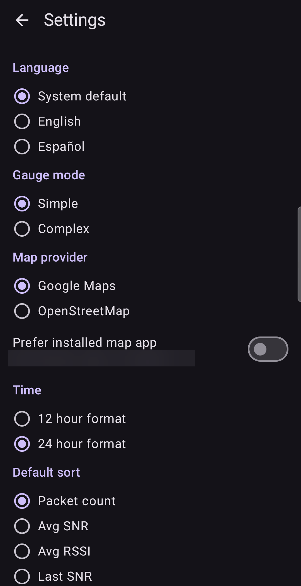
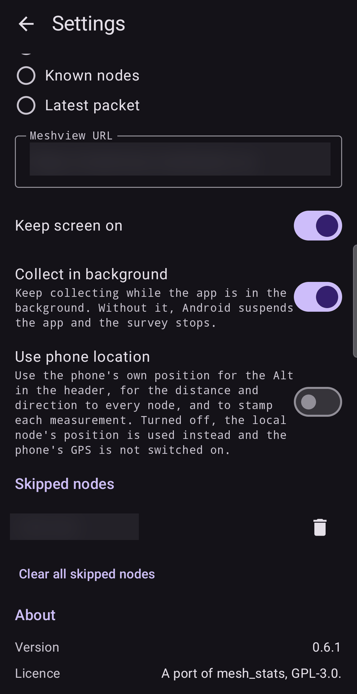

# Settings

Open **Settings** from the ⋮ menu on any main tab.

## Display

| Setting | Choices | What it does |
| :--- | :--- | :--- |
| **Language** | System default, English, Español | The language of the app. |
| **Gauge mode** | Simple, Complex | How the signal bars are drawn ([Relays](02-relays.md)). |
| **Time** | 12 hour, 24 hour | The clock format used everywhere in the app. |
| **Default sort** | Packet count, Avg SNR, Avg RSSI, Last SNR, Last RSSI, Node name, Known nodes, Latest packet | How lists are sorted when the app starts. |

## Maps

| Setting | What it does |
| :--- | :--- |
| **Map provider** | **Google Maps** or **OpenStreetMap**: the site used for map links. |
| **Prefer installed map app** | When on, coordinates open in a map app installed on your phone. The line below the switch tells you which: one app, several (the system will ask), or none. |

Some map apps work with **offline maps**. If you use one of them and choose **Prefer installed map
app**, your coordinates can be shown on a map even when there is no Internet, for example in the
mountains or at sea. Download the map for the area in that app before you go.

## Links

**Meshview URL** is the base address of a Meshview site. When it is set, node cards show a
**Meshview** link to that node's page. Leave it empty if you do not use one.
(In the screenshot the field is hidden to keep the example neutral.)

## Collecting

| Setting | What it does |
| :--- | :--- |
| **Keep screen on** | Stops the screen from switching off while the app is in front. Handy for a long test. It uses more battery. |
| **Collect in background** | Keeps collecting while the app is in the background. A notification, **Mesh Relay is running**, shows the packet counts. Without this setting, Android may suspend the app, and your survey stops. |
| **Use phone location** | When on, the app uses the phone's own position for the **Alt** in the header, for the distance and direction to every node, and to stamp every measurement. When off, your node's position is used instead and the phone's GPS is not switched on. |

The location choice decides what the **🌐** button on the [Graph](06-graph.md) and the position
columns of an [export](07-data.md) can show. If neither the phone nor the node has a position,
those places stay empty.

## Skipped nodes

The list of nodes you told the app to ignore as relay candidates ([Relay details](03-relay-details.md)).
Tap the bin to bring one back, or **Clear all skipped nodes** to bring all back everywhere.
(In the screenshot the entry is hidden.)

## About

Shows the app **Version** and **Licence**. The app is free software under the GPL-3.0.

Next: [Recipes](09-recipes.md).
